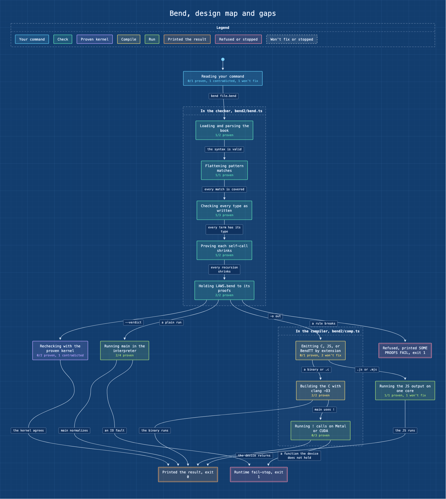

# gap-map

Find out what a language still needs before it does everything it promises. Claude writes a map of the language's pipeline and one obligation per promise, with the line that promises it, the code that owns it, and the existing tests that prove it. A script runs those tests, decides which obligations are proven with fixed rules, and draws the map. The model never marks an obligation as proven.



<sub>The map of Bend at commit b2fe9ce0, from 39 real Bend tests run on this machine. Regenerate it with the commands in [references/bend.md](skills/gap-map/references/bend.md).</sub>

## Install

```
/plugin marketplace add lee-eojin/lim
/plugin install gap-map@lim
```

Needs Node.js 18 or later. gap-map installs nothing. The target's own toolchain runs the fixtures, so for Bend you need `bun`, and clang for the C lane.

## Use

Run `/gap-map:gap-map`. Asking Claude what a language is missing, where its gaps are, or what design it still needs can also start it.

```
/gap-map:gap-map Map Bend at ~/orca/workspaces/bend/main-2 against its guide and README.
/gap-map:gap-map Rerun the Bend map after the last pull and tell me what reopened.
/gap-map:gap-map Add an obligation for the planned U64 type.
```

What happens:

1. Claude reads what the project promises: a proven spec if there is one, the guide, the README, the list of things it will not fix, and the changelog. It writes the goal as one sentence a test could falsify.
2. It writes `gap-map.json`: the stages, labeled with what the tool is doing ("Checking every type as written"), the transitions, labeled with what makes them happen ("-o out"), and the obligations. Each obligation names the case kinds it needs (positive, negative, malformed, boundary, parity, teardown) and existing tests for each.
3. It writes one verifier per lane, copying the project's own test harness rules, and shows each verifier failing once on a variant that must fail.
4. It runs `gapmap.mjs run`, which runs every fixture without a shell and with a time limit, and writes `gaps.md`, `status.json`, and `map.svg`.
5. Claude reports the design decisions the project has to make first, then the gaps stage by stage, what is proven, and what the map leaves out.

## How an obligation is decided

An obligation is proven only when all of these hold:

- its `source` and `owner` pointers resolve to a file and line that exist;
- every case kind it needs has at least one fixture;
- every fixture passed a verifier run whose authority can observe the claim (a verifier that only reads files never closes a claim that needs a run);
- the result applies to what is there now: a fixture, the owner file, the verifier, or a script it runs changed after the run reopens the obligation.

A contradiction between two sources makes it `contradicted`, even when every fixture passes. An open unknown keeps it `open`. `blocked` means this machine cannot observe it. `wontfix` is shown in the map and the ledger and never counted as proven. The rule comes from the closure rule of [REA's reconstruction obligation ledgers](https://github.com/morluto/rea/blob/main/docs/reconstruction-obligation-ledgers.md): authenticity, authority, and applicability are checked separately, and nothing counts as verified by being marked.

## Measured

[`evals/gap-map/behaviors.csv`](../../evals/gap-map/behaviors.csv) lists <!--total-->41 behaviors. Unit tests in CI cover <!--tested-->36 of them, running the script against temporary projects with `node` verifiers. The other <!--rest-->5 need a model run or a real target: the four the benchmark below measures, and the run against Bend itself, recorded in [references/bend.md](skills/gap-map/references/bend.md): 39 real Bend tests passed on the interpreter, C, and JS lanes, and the interpreter verifier failed two expected-failure tests once stderr was left out.

A blinded benchmark in [`evals/gap-map/`](../../evals/gap-map/) copies a small calculator language (a README, a guide, a won't-fix list, five `#|` tests, and a `gap-map.json` with stages and a verifier but no obligations) to a temporary folder with one commit, and runs `/gap-map:gap-map` headlessly with only `Read,Grep,Glob,Write,Edit,Skill,Bash(node:*)` in don't-ask mode. Seven promises carry traps: a test that fails because the implementation is wrong, a promise with no test, a number size the README and the guide state differently, and a won't-fix item. The harness runs the map again itself, matches each obligation to a promise by its `source` line, and scores the promise correct, overclaimed, missed, or incomplete; a changed or added file outside `gap-map.json` and `gap-map/` is tampering. Without a model, an honest reference map scores all seven correct and an overclaiming one scores none correct.

Results from 2026-10-31, claude-opus-5-5, Claude Code 2.1.316, three runs:

| Run | Correct | Overclaimed | Missed | Incomplete | Tampered | Cost | Time |
|---|---|---|---|---|---|---|---|
| 1 | 7 of 7 | 0 | 0 | 0 | no | $0.51 | 101 s |
| 2 | 6 of 7 | 0 | 0 | 1 | no | $0.54 | 99 s |
| 3 | 7 of 7 | 0 | 0 | 0 | no | $0.45 | 81 s |

The failing test and the untested promise stayed open in every run, and the number size was a contradiction in every run. The one incomplete is the guide line that holds two promises, binding a name and refusing to bind it again: run 2 wrote one obligation for both with a positive case, and no test binds a name and then prints it, so it stayed open. The case was not changed after the runs.

## Files

`gap-map.json` lives where you choose; when the target keeps an allow list of files, keep it outside the target and point `root` at it. Next to it, `gap-map/` holds `results.json` (each fixture's last run with its SHA-256), `status.json`, `gaps.md`, `map.svg`, and, for long runs, `decisions.tsv`, the trail of choices that shaped the map. Deleting `gap-map/` resets the results.

## Limits

- The layout is a simple layered one. A map with many crossing transitions stays readable but is not optimal.
- A verifier is one command. A lane that needs a build and a run needs a small wrapper script, which is code Claude writes and a person reviews.
- A pass covers the fixtures named in the map, not the whole test suite. The report says how large the sample is.
