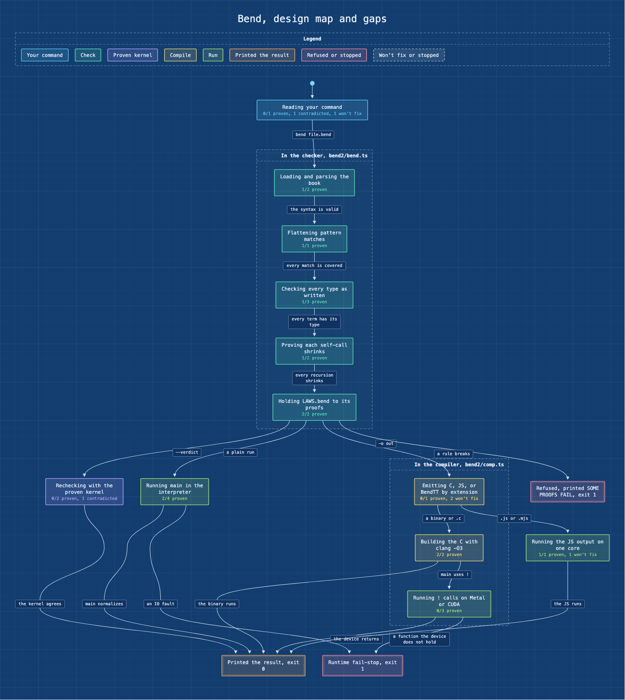

# gap-map

Find out what a language still needs before it does everything it promises. Claude writes a map of the language's pipeline and one obligation per promise, with the line that promises it, the code that owns it, and the existing tests that prove it. A script runs those tests, decides which obligations are proven with fixed rules, and draws the map. The model never marks an obligation as proven.



<sub>The map of Bend at commit b2fe9ce0, from 39 real Bend tests run on this machine. Regenerate it with the commands in [references/bend.md](skills/gap-map/references/bend.md).</sub>

## Install

```
/plugin marketplace add lee-eojin/lim
/plugin install gap-map@lim
```

Needs Node.js 18 or later. gap-map installs nothing. The target's own toolchain runs the fixtures, so for Bend you need `bun`, and clang for the C lane.

## Use

Run `/gap-map:gap-map`. Asking Claude what a language is missing, where its gaps are, or what design it still needs can also start it.

```
/gap-map:gap-map Map Bend at ~/orca/workspaces/bend/main-2 against its guide and README.
/gap-map:gap-map Rerun the Bend map after the last pull and tell me what reopened.
/gap-map:gap-map Add an obligation for the planned U64 type.
```

What happens:

1. Claude reads what the project promises: a proven spec if there is one, the guide, the README, the list of things it will not fix, and the changelog. It writes the goal as one sentence a test could falsify.
2. It writes `gap-map.json`: the stages, labeled with what the tool is doing ("Checking every type as written"), the transitions, labeled with what makes them happen ("-o out"), and the obligations. Each obligation names the case kinds it needs (positive, negative, malformed, boundary, parity, teardown) and existing tests for each.
3. It writes one verifier per lane, copying the project's own test harness rules, and shows each verifier failing once on a variant that must fail.
4. It runs `gapmap.mjs run`, which runs every fixture without a shell and with a time limit, and writes `gaps.md`, `status.json`, and `map.svg`.
5. Claude reports the design decisions the project has to make first, then the gaps stage by stage, what is proven, and what the map leaves out.

## How an obligation is decided

An obligation is proven only when all of these hold:

- its `source` and `owner` pointers resolve to a file and line that exist;
- every case kind it needs has at least one fixture;
- every fixture passed a verifier run whose authority can observe the claim (a verifier that only reads files never closes a claim that needs a run);
- the result applies to what is there now: a fixture, the owner file, the verifier, or a script it runs changed after the run reopens the obligation.

A contradiction between two sources makes it `contradicted`, even when every fixture passes. An open unknown keeps it `open`. `blocked` means this machine cannot observe it. `wontfix` is shown in the map and the ledger and never counted as proven. The rule comes from the closure rule of [REA's reconstruction obligation ledgers](https://github.com/morluto/rea/blob/main/docs/reconstruction-obligation-ledgers.md): authenticity, authority, and applicability are checked separately, and nothing counts as verified by being marked.

## Measured

[`evals/gap-map/behaviors.csv`](../../evals/gap-map/behaviors.csv) lists <!--total-->47 behaviors. Unit tests in CI cover <!--tested-->42 of them, running the script against temporary projects with `node` verifiers. The other <!--rest-->5 need a model run or a real target: the four the benchmark below measures, and the run against Bend itself, recorded in [references/bend.md](skills/gap-map/references/bend.md): 39 real Bend tests passed on the interpreter, C, and JS lanes, and the interpreter verifier failed two expected-failure tests once stderr was left out.

A blinded benchmark in [`evals/gap-map/`](../../evals/gap-map/) copies two small tools to a temporary folder with one commit, each with its docs, `#|` tests, and a `gap-map.json` holding stages and a verifier but no obligations, and runs `/gap-map:gap-map Map this project against what its documentation promises: add an obligation for every promise to gap-map.json and run it.` headlessly with only `Read,Grep,Glob,Write,Edit,Skill,Bash(node:*)` in don't-ask mode. The promises carry traps:

- a calculator language (README, guide, won't-fix list, 7 promises): a test that fails because the implementation is wrong, a promise with no test, a number size the README and the guide state differently, and a won't-fix item;
- a JSON line filter (README and changelog, 5 promises): a test that fails because its expectation is wrong while the code is right, a test hidden in a nested folder, a promise stated only in the changelog, and a feature the README lists as planned.

The harness runs the map again itself, matches each obligation to a promise by its `source` line, and scores the promise correct, overclaimed (proven when it must not be, or not marked as required), missed (no obligation points at it), stricter (left open only because it asked for case kinds no test covers, after at least one case kind had a fixture), or incomplete (anything else left open where the tests could close it). A changed or added file outside `gap-map.json` and `gap-map/` is tampering. Without a model, an honest reference map scores every promise correct and an overclaiming one none; a map that asks for an extra uncovered case scores stricter, and one that lost its only fixture scores incomplete. Stricter cannot tell a case Claude invented from one a test it failed to find would have covered; the run records list every open reason so a reader can check.

Results with claude-opus-5-5 and Claude Code 2.1.316, three runs over both tools on each date:

| Date | Skill | Promises | Correct | Stricter | Overclaimed | Missed | Incomplete | Tampered runs | Cost per tool run | Time per tool run |
|---|---|---|---|---|---|---|---|---|---|---|
| 2026-11-01 | before anchors | 36 | 32 | 4 | 0 | 0 | 0 | 0 of 6 | $0.42 to $0.48 | 72 to 106 s |
| 2026-11-03 | this version | 36 | 33 | 3 | 0 | 0 | 0 | 0 of 6 | $0.83 to $1.03 | 164 to 420 s |

This version's numbers come from the three `2026-11-03-claude-opus-5-5-rebaseline-*.json` files in [`evals/gap-map/results/`](../../evals/gap-map/results/). No run on either date proved a failing or untested promise, missed a promise, or changed a test. Every stricter promise was checked against its recorded reasons. In all three runs of this version, the changelog's "a number greater than n" stayed open for a boundary case (a field equal to n) and a case with a field that is not a number, which no test covers: the one test of that promise holds only the values 4 and 12. Two runs made the second case a negative case on its own obligation, and one made it a malformed case on the same obligation. The three 2026-11-01 runs gave this promise the same verdict for the same kinds of case.

The fourth stricter verdict on 2026-11-01 was the guide line that holds two promises, written as one obligation that also asked for a positive case; no test binds a name and then prints it. All three runs of this version wrote that line as two obligations, as two of the 2026-11-01 runs did. The refusal closes, which scores correct, and the binding stays open for the same missing test. The gap is still reported, so 33 against 32 reflects how the line was split, not a better map.

Verdicts did not vary between the three runs of this version. A run of both tools cost $1.73 to $1.86. Five of the six tool runs took 164 to 189 s. One calculator run took 420 s for 42 turns and $1.03, against 184 and 189 s for 34 and 37 turns and $0.90 and $0.95, so more work does not account for all of that time. The records do not say what does.

A tool run costs about twice what it did on 2026-11-01 (median $0.90 against $0.45) and takes twice as long (median 186 s against 93 s). It takes more turns (25 to 42 against 18 to 26), and each turn costs more (median $0.028 against $0.021). The records hold one token total per run, so they do not show which kind of token grew. The cases, the prompt, and the scoring did not change. The skill gained the `anchors` instruction and the runs moved from macOS to Linux, so these runs cannot say which of the two raised the cost.

Trial maps in scratch folders do not explain the rise alone: 5 of 6 tool runs wrote one, against 2 of 6 on 2026-11-01, but the JSON filter run that wrote only `gap-map.json` still cost $0.83. Those folders sit outside the temporary project, so the tamper check does not see them and the scorer does not read them. One calculator run found a folder an earlier run left in `/tmp` and reported that it did not use it.

An earlier run kept for inspection also raised a design question the benchmark did not plant: every test writes `query:` before the query, which the README never mentions. The expected results were not changed after any run.

## Files

`gap-map.json` lives where you choose; when the target keeps an allow list of files, keep it outside the target and point `root` at it. Next to it, `gap-map/` holds `results.json` (each fixture's last run with its SHA-256), `status.json`, `gaps.md`, `map.svg`, and, for long runs, `decisions.tsv`, the trail of choices that shaped the map. Deleting `gap-map/` resets the results.

## Limits

- The layout is a simple layered one. A map with many crossing transitions stays readable but is not optimal.
- A verifier is one command. A lane that needs a build and a run needs a small wrapper script, which is code Claude writes and a person reviews.
- A pass covers the fixtures named in the map, not the whole test suite. The report says how large the sample is.
